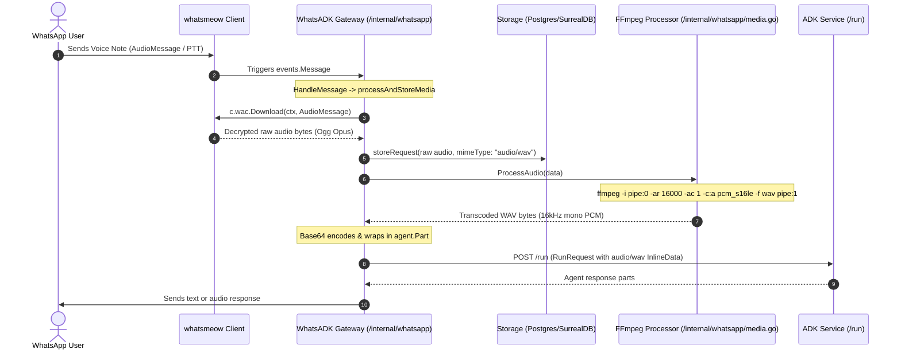

# Voice Message & Audio Pipeline

This document details how incoming WhatsApp voice messages (Push-to-Talk / PTT) and audio clips are intercepted, downloaded, normalized, and dispatched to the ADK agent, as well as the exact payload schema sent to ADK.

---

## 1. Architectural Overview



---

## 2. Inbound Processing Lifecycle

### Step 1: Detection & Identification
Incoming messages are handled by `HandleMessage` in [`/internal/whatsapp/client.go`](/internal/whatsapp/client.go).
When an incoming message contains an audio attachment or a Push-to-Talk (PTT) voice note, it is populated under `msg.Message.AudioMessage`:

```go
switch {
case m.ImageMessage != nil:
    media, mimeType = m.ImageMessage, "image/jpeg"
case m.AudioMessage != nil:
    media, mimeType = m.AudioMessage, "audio/wav"
// ...
}
```

### Step 2: Download & Decryption
The gateway invokes the `whatsmeow` client method:
```go
data, err = c.wac.Download(ctx, media)
```
This fetches the encrypted binary from WhatsApp's media servers, validates cryptographic hashes (`FileSHA256` / `FileEncSHA256`), and decrypts the audio payload in memory.

### Step 3: Raw Persistence
The decrypted raw audio is immediately persisted into the configured database (Postgres or SurrealDB) or filesystem via:
```go
c.storeRequest(ctx, userID, uniqueID, data, msg.Info.Timestamp, mimeType, msg.Info.IsFromMe)
```

### Step 4: Transcoding (`internal/whatsapp/media.go`)
WhatsApp voice notes are encoded as Ogg Opus (`audio/ogg; codecs=opus`). To ensure broad compatibility with speech-to-text models and Gemini/ADK multimodal endpoints, `Processor.ProcessAudio()` pipes the audio through `ffmpeg`:

```bash
ffmpeg -i pipe:0 -ar 16000 -ac 1 -c:a pcm_s16le -f wav pipe:1
```

- **Max Media Size**: Capped at `MaxMediaSize` (10 MB).
- **Audio Codec**: `pcm_s16le` (16-bit linear PCM).
- **Sample Rate**: 16,000 Hz (16 kHz).
- **Channels**: 1 (mono).
- **Container**: WAV (`audio/wav`).

---

## 3. ADK Payload Specification

Once transcoded, the binary WAV audio is base64-encoded and structured as an [`agent.Part`](/internal/agent/client.go).

### Go Struct Definition

```go
type RunRequest struct {
    AppName    string   `json:"appName"`
    UserID     string   `json:"userId"`
    SessionID  string   `json:"sessionId"`
    NewMessage *Message `json:"newMessage"`
    Streaming  bool     `json:"streaming,omitempty"`
}

type Message struct {
    Role  string `json:"role"`
    Parts []Part `json:"parts"`
}

type Part struct {
    Text       string      `json:"text,omitempty"`
    InlineData *InlineData `json:"inlineData,omitempty"`
}

type InlineData struct {
    MimeType string `json:"mimeType"`
    Data     string `json:"data"` // base64-encoded
}
```

### Wire JSON Sent to ADK (`POST /run` or `POST /run_sse`)

```json
{
  "appName": "adk-assistant",
  "userId": "919876543210",
  "sessionId": "919876543210",
  "newMessage": {
    "role": "user",
    "parts": [
      {
        "inlineData": {
          "mimeType": "audio/wav",
          "data": "UklGRiQAAABXQVZFZm10IBAAAAABAAEAQB8AAEAfAAABAAgAZGF0YQAAAAA..."
        }
      }
    ]
  }
}
```

> [!NOTE]
> If a caption or contextual text accompanied the audio message, a `{ "text": "..." }` part is included alongside the `inlineData` part in the `parts` array.

---

## 4. WhatsApp Business Cloud API (`waba-gateway`)

In [`/cmd/waba-gateway/main.go`](/cmd/waba-gateway/main.go):
- Inbound media is detected via webhook payloads (`media_id`).
- The binary payload is retrieved via `wabaClient.GetMediaURL` and `wabaClient.DownloadMedia`.
- Inbound media is stored into persistence.
- *Note:* In `waba-gateway`, automatic multimodal forwarding to ADK is currently enabled for image MIME types (`image/*`). Full audio normalization to ADK is implemented in the primary WhatsApp gateway (`/internal/whatsapp`).
